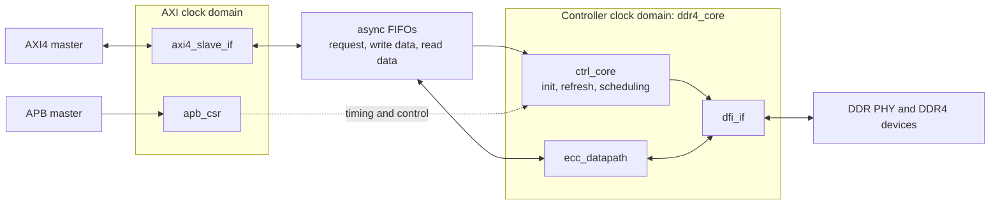
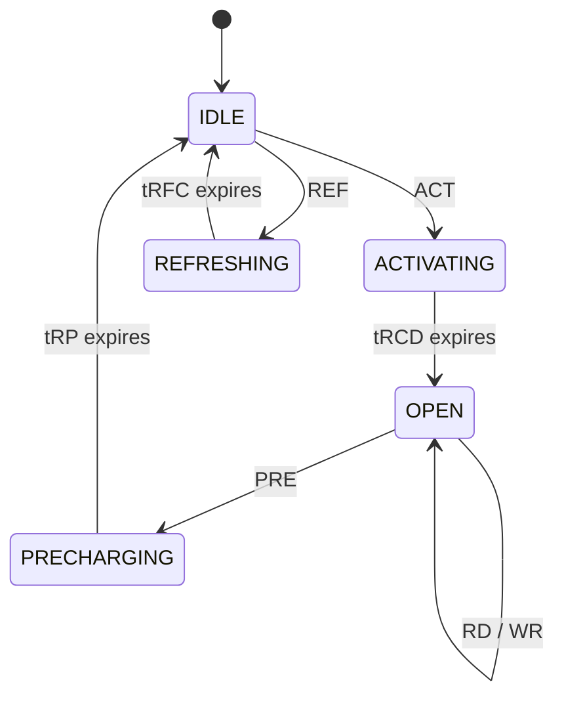

# AXI4 DDR4 Memory Controller Design and UVM Verification

A synthesizable DDR4 SDRAM controller in SystemVerilog with an AXI4 slave data
interface, an APB register interface, SECDED error correction and a DFI-style
PHY interface.

**Status: RTL complete and verified in simulation with a UVM environment:
316/316 regression runs pass at four clock ratios, with 97.0 % functional and
89.7 % code coverage and 92 assertions.** It has not been run against a vendor
memory model, synthesized, or taken through CDC or formal analysis. See
[docs/verification.md](docs/verification.md) for exactly what has and has not
been checked, and [docs/bug_log.md](docs/bug_log.md) for the bugs found on the way.

## Features

- AXI4 slave, 64-bit data, INCR bursts up to 256 beats
- APB register block: every JEDEC timing parameter, mode-register values and
  latencies are programmable at run time
- DDR4 power-up initialization, auto-refresh with postponement, self-refresh
- Open-page scheduling with one state machine and timer set per bank (16 banks)
- Hsiao (72,64) SECDED ECC on every 64-bit word, with error counters and interrupt
- Two clock domains joined by Gray-pointer asynchronous FIFOs
- DFI-style command, write-data and read-data interface at a 1:4 clock ratio

Target configuration: 8 Gb x8 DDR4 devices (nine of them for a 72-bit bus),
DDR4-1600, 200 MHz controller clock, 100 MHz AXI clock.

## Architecture



A request enters over AXI4, is packed into one memory burst of eight 64-bit
words, crosses into the controller clock domain, and is turned into a legal
sequence of DDR4 commands. Write data gains check bits on the way out; read data
is corrected on the way back.

Inside `ctrl_core`, one arbiter chooses a command each cycle from the guards
supplied by the bank state machines, the cross-bank timers and the refresh
manager:



### Register map (APB)

| Offset | Register | Contents |
| --- | --- | --- |
| `0x000` | CTRL | [0] self-refresh request, [1] init start |
| `0x004` | STATUS | [0] init done, [1] in self-refresh, [2] refresh overflow (read-only) |
| `0x008` | INT_EN | [0] corrected error, [1] uncorrectable error, [2] refresh overflow |
| `0x00C` | INT_STAT | Same bits; write 1 to clear |
| `0x010` | ECC_CE | Corrected-word count, saturating; any write clears |
| `0x014` | ECC_UE | Uncorrectable-word count, saturating; any write clears |
| `0x018` | LATENCY | [2:0] DFI write latency, [6:4] read-enable latency |
| `0x01C` | REFRESH | [15:0] tREFI interval, [19:16] urgent threshold |
| `0x020`–`0x030` | T_RST, T_CKE, T_XPR, T_DLLK, T_CKESR | Initialization and self-refresh waits |
| `0x040 + 4n` | MR0–MR6 | Mode-register opcodes |
| `0x080 + 4k` | TIMING0–21 | One JEDEC timing parameter each (k = 0 is tRCD) |

Configuration is quasi-static: program it before setting `CTRL.init_start`.

## Repository layout

| Path | Contents |
| --- | --- |
| `rtl/` | Synthesizable RTL (19 files) and `files.f` compile order |
| `tb/` | Directed self-checking testbenches and the behavioral PHY/memory model |
| `dv/` | UVM environment: agents, register model, scoreboard, protocol checker, coverage, SVA, 21 tests ([dv/README.md](dv/README.md)) |
| `scripts/` | Verilator regression script and the ECC matrix generator |
| `docs/` | [Verification plan and results](docs/verification.md), [bug log](docs/bug_log.md) |

### RTL files

| File | Purpose |
| --- | --- |
| `ddr4_pkg.sv` | Shared types, command encoding, timing struct, ECC matrix |
| `cdc_cells.sv` | Two-flop synchronizer and reset synchronizer |
| `async_fifo.sv` | Dual-clock FIFO with Gray-coded pointers |
| `sync_fifo.sv` | Single-clock FIFO |
| `addr_map.sv` | AXI address to row, bank group, bank and column |
| `axi4_slave_if.sv` | AXI4 front end: bursts to memory requests and back |
| `apb_csr.sv` | Configuration and status registers, interrupt |
| `bank_fsm.sv` | Per-bank state, open row and timers |
| `global_timers.sv` | Cross-bank and bus-turnaround timers |
| `refresh_mgr.sv` | Pending-refresh accounting |
| `init_fsm.sv` | Power-up and mode-register sequence |
| `lowpower_fsm.sv` | Self-refresh entry and exit |
| `cmd_arbiter.sv` | Priority selection of one legal command per cycle |
| `ctrl_core.sv` | Control path integration |
| `ecc.sv` | Hsiao (72,64) encoder and decoder |
| `ecc_datapath.sv` | Burst-wide ECC (eight words in parallel) |
| `dfi_if.sv` | DFI command and data timing |
| `ddr4_core.sv` | Controller-clock-domain integration |
| `ddr4_ctrl_top.sv` | Top level |

## Running the tests

### UVM regression (Questa)

From the repository root:

```sh
python dv/scripts/run_test.py sanity_test                # compile and run one test
python dv/scripts/run_test.py axi_rand_test 7 fast       # seed 7, AXI clock 400 MHz
python dv/scripts/regress.py --clk all --cov             # 316 runs, merged coverage
```

See [dv/README.md](dv/README.md) for all options.

### Directed testbenches

With Verilator 5.x:

```sh
./scripts/run_sims.sh
```

With Questa:

```sh
vlib work
vlog -sv -f rtl/files.f tb/*.sv
vsim -c tb_async_fifo     -do "run -all; quit"
vsim -c tb_ecc            -do "run -all; quit"
vsim -c tb_timers         -do "run -all; quit"
vsim -c tb_ctrl_core      -do "run -all; quit"
vsim -c tb_ctrl_core -gSTRESS=1 -do "run -all; quit"
vsim -c tb_ddr4_core      -do "run -all; quit"
vsim -c tb_ddr4_ctrl_top  -do "run -all; quit"
```

Each test prints one summary line ending in `PASS` or `FAIL`.

## Verification summary

### UVM environment

| Result | |
| --- | --- |
| Regression | 316 / 316 runs pass: 21 tests × seeds × 4 AXI/controller clock ratios |
| Functional coverage | 97.0 % merged (AXI, DFI command sequences, binding timing rule, refresh debt, self-refresh, ECC per bit and word, registers, configuration) |
| Code coverage | 89.7 % merged (statement, branch, condition, expression, FSM, toggle) |
| Assertions | 92 bound SVA properties, all passing, each with a cover |

Data is checked by a scoreboard against a reference memory, ordered by a probe
on the request-FIFO push. DDR4 protocol is checked by an independent model that
judges every command against the programmed timing, citing the datasheet table
for each rule. The DFI agent plays the PHY and DRAM and injects single- and
double-bit errors. Details and open coverage items: [docs/verification.md](docs/verification.md).

### Directed testbenches

| Testbench | What it checks |
| --- | --- |
| `tb_async_fifo` | 20,000 random words at three clock ratios; ordering, full, empty, free count |
| `tb_ecc` | Every single-bit error corrected (72), every double-bit error detected (2,556) |
| `tb_timers` | Each timing guard opens in exactly the required cycle |
| `tb_ctrl_core` | 20,000 random requests; an independent protocol monitor checks every command |
| `tb_ddr4_core` | End-to-end data integrity with injected bit errors and read backpressure |
| `tb_ddr4_ctrl_top` | AXI4 and APB traffic through the whole design, including error cases |

The command truth table, initialization order and timing defaults were checked
against the Micron 8 Gb DDR4 SDRAM datasheet (MT40A1G8, Rev. N).

## Known limitations

- AXI: INCR bursts of full-width beats only; a beat is stored only when all
  eight strobes are set. Other cases return SLVERR.
- DFI data timing is cycle-aligned, not phase-accurate.
- No precharge power-down, periodic ZQ calibration, memory initialization or scrubbing.
- Requests are served strictly in order (no look-ahead scheduling).
- Mode-register default opcodes are placeholders and are not verified.

## Roadmap

- [x] UVM environment with functional coverage
- [ ] Coverage closure (open items in [docs/verification.md](docs/verification.md#open-items))
- [ ] Formal proofs: FIFO pointers, bank timers, refresh starvation
- [ ] CDC analysis
- [ ] Synthesis and timing at 200 MHz
- [ ] Phase-accurate DFI write alignment
- [ ] Pin-level PHY model and a run against a vendor DDR4 model

## References

- Micron, *8Gb: x4, x8, x16 DDR4 SDRAM* datasheet (MT40A1G8), Rev. N
- JEDEC JESD79-4, *DDR4 SDRAM Standard*
- DFI Specification, ddr-phy.org
- C. Cummings, "Simulation and Synthesis Techniques for Asynchronous FIFO Design", SNUG 2002
- M. Y. Hsiao, "A Class of Optimal Minimum Odd-weight-column SEC-DED Codes", IBM J. R&D, 1970
- Arm, *AMBA AXI and ACE Protocol Specification*; *AMBA APB Protocol Specification*

Author: Raj Balan (M.S in Computer Engineering), George Mason University
